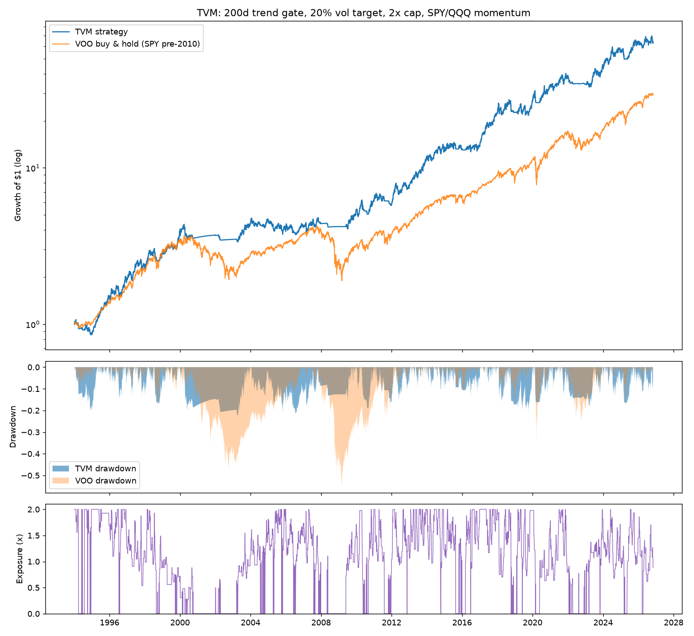
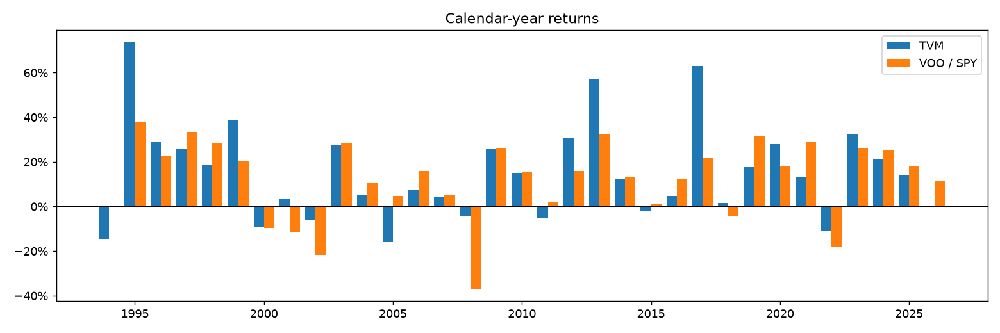

# TVM: Trend-gated, Volatility-targeted Momentum

An automated paper-trading strategy designed to beat buy-and-hold VOO over a
full market cycle, with roughly half the drawdown. Python, daily bars, ETFs only,
runs against an Alpaca paper account. A second strategy built on the open-source
[Kronos](https://github.com/shiyu-coder/Kronos) candlestick foundation model can
be paper traded alongside it (see [below](#kronos-an-ai-candlestick-forecaster-as-a-second-strategy)).



## Why this can beat VOO

Holding VOO means holding 1.0x the S&P 500 at all times, including through
-34% (2020), -55% (2008) and -50% (2000-02) drawdowns. Three well-documented
effects let a rules-based strategy do better over time:

1. **Trend gate (time-series momentum).** When the index is below its 200-day
   moving average, forward returns are lower and volatility is much higher.
   Stepping aside into T-bills during those regimes skips most of the big
   crashes at the cost of some whipsaw. This is where the drawdown reduction
   comes from.
2. **Volatility targeting.** Sizing exposure to a fixed volatility budget
   (20%/yr) means *more* than 1x in calm uptrends and *less* than 1x in
   turbulent ones. Because volatility clusters, that is a better risk/return
   tradeoff than constant 1x, and it's what allows the strategy to compound
   faster than the index without exceeding its volatility much. Exposure above
   1x is implemented with the 2x ETFs SSO / QLD, so no margin is needed.
   A -34%-style drawdown on the index becomes roughly -21% here.
3. **Relative momentum between SPY and QQQ.** Whichever of the two has the
   better trailing 6-month return is held, re-evaluated at most monthly.
   This is the least robust of the three (it rides a 15-year tech tailwind),
   so the README also reports a SPY-only variant.

In short: own the market when the market is rewarding ownership, own more of
it when it is calm, and own none of it when it is in a downtrend.

## The rules

Every trading day, using closes up to and including today:

| Step | Rule | Default |
|---|---|---|
| Regime | risk-on iff `SPY close > SMA(SPY, 200)`; otherwise 100% in `BIL` (1-3 month T-bills) | `sma_window=200` |
| Asset | hold whichever of `SPY` / `QQQ` has the higher 126-day return; re-pick only after holding the current one at least 21 trading days | `momentum_window=126`, `min_hold_days=21` |
| Size | `exposure = clip(0.20 / realized_vol, 0, 2.0)` where `realized_vol` = max of the two assets' 20-day daily-return std, annualised | `target_vol=0.20`, `vol_window=20`, `max_leverage=2.0` |
| Implement | `exposure <= 1`: `exposure` in the 1x ETF, rest in `BIL`. `exposure > 1`: `(exposure-1)` in the 2x ETF (`SSO`/`QLD`), `(2-exposure)` in the 1x ETF | |
| Rebalance | only trade when the regime flips, the asset changes, or target exposure moves more than 0.10 from what is held | `rebalance_band=0.10` |

All parameters live in [`tvm/config.py`](tvm/config.py) and can be overridden
with a JSON file ([`config.example.json`](config.example.json)).

## Backtest results

Benchmark is VOO; SPY (same index) is spliced in before VOO's Sept 2010
inception. Costs: 2 bps per unit of fund value traded. Exposure above 1x uses
actual SSO/QLD returns from their 2006 inception and a synthetic
`2*r - (T-bill + 0.5% + 0.9% expense)` before that. Signal on close *t*,
position earns *t -> t+1*. Sharpe is excess over T-bills.

```
=== Full history (1994->)  (32.8y, 1288 rebalances) ===
  TVM strategy                 CAGR  13.45%  Vol 17.38%  Sharpe  0.67  MaxDD -22.81%  Calmar  0.59  x 62.66
  VOO buy & hold               CAGR  10.82%  Vol 18.73%  Sharpe  0.51  MaxDD -55.19%  Calmar  0.20  x 29.08
  rolling 3y win rate vs VOO: 69%   5y: 79%   10y: 96%

=== Out-of-sample: dot-com + GFC (1999-04 -> 2010-09)  (11.4y, 370 rebalances) ===
  TVM strategy                 CAGR   4.74%  Vol 14.45%  Sharpe  0.21  MaxDD -22.81%  Calmar  0.21  x  1.70
  VOO buy & hold               CAGR   0.36%  Vol 21.99%  Sharpe  0.01  MaxDD -55.19%  Calmar  0.01  x  1.04

=== VOO era (2010-09 ->)  (16.1y, 723 rebalances) ===
  TVM strategy                 CAGR  16.90%  Vol 18.48%  Sharpe  0.85  MaxDD -20.62%  Calmar  0.82  x 12.39
  VOO buy & hold               CAGR  14.74%  Vol 16.93%  Sharpe  0.81  MaxDD -33.99%  Calmar  0.43  x  9.17
  rolling 3y win rate vs VOO: 73%   5y: 74%   10y: 100%

=== Real 2x ETFs available (2007 ->)  (19.8y, 841 rebalances) ===
  TVM strategy                 CAGR  14.60%  Vol 17.93%  Sharpe  0.76  MaxDD -20.62%  Calmar  0.71  x 14.84
  VOO buy & hold               CAGR  10.86%  Vol 19.55%  Sharpe  0.55  MaxDD -55.19%  Calmar  0.20  x  7.70
```



What to expect year to year: TVM beats the index in only ~40-50% of calendar
years. It loses in whipsaw years (2011, 2015-16), in sharp V-shaped recoveries
where the trend gate re-enters late (2019, 2021, 2025-26), and it wins big in
bear markets (2001-02, 2008, 2022) and in calm, trending bull years where it
runs 1.5-2x (2013, 2017). The edge shows up over 5-10 year windows, not
quarters. If you need to beat VOO *every* year, no systematic strategy will do
that.

### Sensitivity (CAGR / MaxDD / Sharpe)

| Variant | 1994-> | 1999-04 -> 2010-09 (OOS) | 2010-09 -> (VOO era) |
|---|---|---|---|
| **VOO buy & hold** | 10.8% / -55.2% / 0.51 |  0.4% / -55.2% / 0.01 | 14.7% / -34.0% / 0.81 |
| **TVM default** | 13.4% / -22.8% / 0.67 |  4.7% / -22.8% / 0.21 | 16.9% / -20.6% / 0.85 |
| No leverage (`max_leverage=1`) | 11.5% / -22.8% / 0.71 |  5.3% / -22.8% / 0.27 | 13.6% / -16.0% / 0.90 |
| SPY only (no QQQ momentum) | 10.7% / -32.1% / 0.53 |  0.6% / -32.1% / -0.05 | 14.4% / -22.8% / 0.74 |
| `target_vol=0.15` | 11.4% / -17.0% / 0.68 |  4.5% / -17.0% / 0.21 | 13.9% / -15.4% / 0.87 |
| `target_vol=0.25` | 15.2% / -28.8% / 0.67 |  5.3% / -28.8% / 0.23 | 19.7% / -22.9% / 0.87 |
| `sma_window=150` | 11.9% / -28.6% / 0.60 |  3.9% / -27.7% / 0.15 | 15.0% / -28.6% / 0.77 |
| `sma_window=250` | 13.2% / -23.1% / 0.65 |  6.4% / -22.3% / 0.32 | 15.3% / -22.3% / 0.77 |
| `momentum_window=63` | 13.3% / -21.9% / 0.67 |  4.9% / -21.9% / 0.22 | 16.4% / -18.9% / 0.84 |
| `momentum_window=252` | 11.7% / -28.4% / 0.58 |  1.4% / -28.4% / -0.02 | 15.9% / -24.0% / 0.79 |
| `vol_window=60` | 12.5% / -23.0% / 0.63 |  4.0% / -22.5% / 0.16 | 15.6% / -23.0% / 0.81 |
| `min_hold_days=0` | 13.0% / -31.9% / 0.65 |  3.3% / -31.9% / 0.11 | 17.2% / -21.7% / 0.86 |
| `rebalance_band=0.20` | 13.7% / -24.2% / 0.68 |  4.9% / -24.2% / 0.22 | 17.1% / -22.0% / 0.86 |
| `cost_bps=10` (5x default costs) | 11.2% / -28.5% / 0.56 |  2.7% / -28.5% / 0.07 | 14.5% / -23.3% / 0.74 |

Takeaways:

- Every variant cuts max drawdown to about half of VOO's or better. On CAGR,
  every variant except SPY-only beats VOO over the full 33 years and over the
  out-of-sample window; in the 2010-2026 bull run the lower-risk settings (no
  leverage, 15% vol target, 5x costs) trail VOO by ~1%/yr while still halving
  drawdown. The structure is what matters; exact parameters are second order.
- `target_vol` is the risk dial. 15% gives VOO-like returns at half the
  drawdown; 25% gives ~5%/yr more than VOO at ~-29% max drawdown.
- The QQQ sleeve adds ~2.5%/yr over the long run but is the component most
  exposed to regime change (it rides a tech tailwind). The no-leverage variant
  beats VOO without any 2x ETF and is the most conservative choice.
- Turnover is ~25x of account value per year (regime flips and asset switches
  dominate, not the band), so costs matter: at 10 bps a round trip the edge
  shrinks noticeably. Alpaca is commission-free and SPY/QQQ/BIL spreads are
  ~1 bp, SSO/QLD ~2-3 bp, so 2 bps is a realistic all-in number.

## Learning from mistakes: the adaptive ensemble

`paper_trade.py` runs an **adaptive ensemble** by default (`--fixed` opts out).
It is built so the strategy can get things wrong and recover, without giving
it the freedom to curve-fit:

1. **A pool of 16 experts** runs as virtual portfolios every day: the TVM
   rules with trend windows 150/200/250 x momentum horizons 3/6/12 months,
   risk budgets 15/20/25%, a no-leverage variant, a SPY-only variant, two
   mistake-aware variants (below), and plain **buy-and-hold** as a safety net.
2. **A Hedge learner** (multiplicative weights with a 6-month forgetting
   half-life) scores each expert on its realised, cost-adjusted returns and
   shifts the real portfolio toward the experts that have been right and away
   from those that just lost. This has a regret bound: over time the blend
   does about as well as the best expert in hindsight. Because buy-and-hold is
   in the pool, the worst case is "drift toward VOO", never "drift toward
   something broken".
3. **Whipsaw memory** (`whipsaw_penalty`): every regime exit that is later
   re-entered at a higher price was a mistake. Each one in the trailing year
   raises the bar for the next entry by 0.5% (capped at 3%). Exits are never
   delayed; leaving late is the costlier error.
4. **Graded trend vote** (`trend_vote_windows`): exposure scaled by the share
   of 100/150/200/250/300-day SMAs the price is above, instead of a single
   200-day switch.
5. **Post-mortem in every report**: the last regime exits are scored
   ("whipsaw (mistake)" or "avoided loss") and the expert leaderboard is
   printed, so you can see what the learner is reacting to.

Everything is recomputed from price history on each run. There is no trained
model to drift, and nothing persisted that could corrupt the decision.

### What the learning did and did not buy (CAGR / MaxDD / Sharpe)

| Variant | 1994-> | 1999-04 -> 2010-09 (OOS) | 2010-09 -> |
|---|---|---|---|
| VOO buy & hold | 10.8% / -55.2% / 0.51 | 0.4% / -55.2% / 0.01 | 14.7% / -34.0% / 0.81 |
| TVM fixed default (in-sample pick) | 13.4% / -22.8% / 0.67 | 4.7% / -22.8% / 0.21 | 16.9% / -20.6% / 0.85 |
| **Adaptive ensemble (live default)** | 12.4% / -22.3% / 0.65 | 4.6% / -22.3% / 0.20 | 15.2% / -19.7% / 0.80 |
| Uniform average of experts (no learning) | 12.3% / -23.1% / 0.65 | 4.0% / -23.1% / 0.16 | 15.3% / -18.7% / 0.83 |
| Whipsaw-aware TVM alone | 13.3% / -24.9% / 0.67 | 6.0% / -19.6% / 0.30 | 16.2% / -22.9% / 0.82 |
| Graded SMA vote TVM alone | 13.3% / -21.7% / 0.68 | 5.6% / -21.3% / 0.27 | 15.9% / -21.7% / 0.82 |
| Aggressive learner (eta=40) | 11.7% / -22.7% / 0.59 | 4.1% / -22.7% / 0.17 | 13.9% / -22.0% / 0.72 |
| 2-expert chase: TVM vs buy-and-hold | 11.5% / -32.9% / 0.62 | 2.8% / -32.9% / 0.08 | 14.4% / -20.8% / 0.81 |

Read this honestly:

- The ensemble beats VOO in every period with lower volatility and roughly
  60% less drawdown, but it does **not** beat the fixed default's backtest.
  It should not: the fixed default's parameters were chosen on this data,
  so its numbers are optimistic. The ensemble's number is what you get when
  you refuse to make that bet.
- The learner adds only a little over a plain average. Experts that are
  variants of the same idea are highly correlated, and recent relative
  performance among them is mostly noise. Pushing the learning rate up
  (eta=40) chases that noise and loses ~1%/yr.
- Chasing between TVM and buy-and-hold with only those two experts is
  actively harmful (drawdown -33%): after a crash the learner piles into TVM
  just as the V-recovery punishes it, and after a long bull run it piles into
  buy-and-hold just before the next bear. Performance-chasing between
  strategies with opposite crisis behaviour is the classic mistake, and the
  wide pool keeps buy-and-hold's weight small enough (~5-15%) to act as a
  hedge rather than a bet.
- The two mistake-aware rules are the real improvement: they give up a
  little in the tuned 2010-2026 window and gain clearly out of sample, which
  is the signature of less overfitting. They are in the pool and can also be
  switched on for the fixed strategy via config.

What "best possible decisions" means here is therefore: robust to the
parameter choice, degrading gracefully toward VOO when trend-following keeps
failing, and provably not far behind the best expert in hindsight. No
system can promise more than that on financial data without lying about it.

```bash
python run_backtest.py --adaptive      # adds the ensemble, learner weights and post-mortem to the report
python paper_trade.py --mode preview   # adaptive by default
python paper_trade.py --mode preview --fixed
```

## Kronos: an AI candlestick forecaster as a second strategy

[Kronos](https://github.com/shiyu-coder/Kronos) (Shi et al., AAAI 2026,
[arXiv:2508.02739](https://arxiv.org/abs/2508.02739)) is an open-source,
MIT-licensed foundation model for candlesticks: a decoder-only transformer
pre-trained on ~12 billion OHLCV bars from 45 exchanges that, given a window
of candles, *samples* plausible future candles. `--strategy kronos` runs
paper trading on it, side by side with TVM, so the two can be compared on
the same days with real paper money.

How it is wired in (`tvm/kronos_signal.py`):

1. Each trading day the last **400 daily SPY and QQQ candles** go into
   `Kronos-small` (24.7M parameters; the inference code is vendored under
   `tvm/kronos_vendor/`, weights come from the Hugging Face Hub). It samples
   **8 five-day candle paths per symbol** (~3 s on a 4-core CPU, no GPU).
2. The paths are summarised as expected 5-day return, dispersion, share of
   paths finishing up, and the mean worst low (`exp_ret`, `std_ret`, `p_up`,
   `exp_min_low`).
3. A simple rule maps that to ETF weights. Default `calibrated`: compare
   today's expected return with the model's own forecasts over the previous
   126 days (a z-score using *prior* days only) and hold the better of
   SPY/QQQ when z > 0, else BIL. Other rules: `direction` (raw sign),
   `relative` (always invested, Kronos only picks SPY vs QQQ), `confidence`
   (sized by z, up to 2x via SSO/QLD), `tvm-veto` (TVM ensemble, but to cash
   when Kronos sees < 35% of paths up).

Why the calibration step exists: zero-shot Kronos has a **persistent bearish
drift** on trending US index data. Over 2022-2026 its mean 5-day forecast was
-2% to -5% against a realised +0.3%, and it was outright bullish on only
8-13% of days out of sample. Its *positive* forecasts arrive almost
exclusively after a 20-day decline (average -1.7%) and were followed by +0.55%
over the next week versus +0.15% otherwise, so the raw signal is a
**dip-buying / mean-reversion detector**, not a trend model. The z-score strips
the drift out without peeking.

### Walk-forward results (Kronos-small, 2022-01 -> 2026-10)

Each day's forecast uses only candles up to that close; the target decided at
the close earns the next day's ETF return, net of 2 bps per dollar traded.
Because the public checkpoint was **pre-trained on data through June 2024**,
the window is split; only the right-hand block is genuinely out of sample for
the model. Full tables: [`results/kronos_backtest_small.md`](results/kronos_backtest_small.md);
chart: `results/kronos_equity_small.png`. Regenerate with
`python run_kronos_backtest.py` (about an hour for the first full run; the
forecasts are cached in `results/kronos_forecasts_*.csv`).

| strategy | 2022-01 -> 2024-06 (in training data) CAGR / MaxDD / Sharpe | **2024-07 -> 2026-10 (out of sample)** CAGR / MaxDD / Sharpe | invested |
|---|---|---|---|
| VOO buy & hold | 7.3% / -24.5% / 0.27 | **16.5% / -18.7% / 0.79** | 100% |
| TVM adaptive ensemble | 13.1% / -15.2% / 0.66 | 6.2% / -17.3% / 0.20 | 100% (avg 0.9x) |
| **Kronos calibrated (z>0)** (paper-trading default) | 15.6% / -17.5% / 0.74 | **14.4% / -18.8% / 0.63** | 47% -> 68% |
| Kronos direction (raw sign) | 14.3% / -13.7% / 0.62 | 12.9% / -14.9% / 0.72 | 43% -> 15% |
| Kronos calibrated (z>0.5) | 12.8% / -11.9% / 0.68 | 13.3% / -18.8% / 0.59 | |
| Kronos relative (SPY vs QQQ) | 4.4% / -26.5% / 0.13 | 15.6% / -18.4% / 0.67 | 100% |
| Kronos confidence (<=2x) | 17.8% / -17.0% / 0.74 | 10.5% / -33.5% / 0.35 | |
| TVM ensemble + Kronos veto | 9.5% / -6.4% / 0.66 | 7.0% / -8.8% / 0.46 | |
| max(TVM, Kronos direction) *(rejected)* | 21.4% / -14.6% / 0.82 | 11.6% / -23.4% / 0.43 | |

Reading it honestly:

- Over the whole window the calibrated Kronos rule beat VOO (15.0% vs 11.7%
  CAGR, Sharpe 0.69 vs 0.50) while invested only 57% of the time. In the
  clean out-of-sample stretch it **did not** beat VOO's 16.5%, though it
  earned 14.4% while in the market two-thirds of the time, and the raw
  `direction` rule made 12.9% while invested just 15% of the time. The
  forecasts carry real information (rank IC of the raw 5-day forecast vs the
  realised return: 0.19-0.22 out of sample), but mostly about rebounds.
- Kronos and TVM are complementary in *character* (TVM rides trends and gets
  hurt by V-shaped reversals such as April 2025; Kronos buys those dips), yet
  the naive combinations tested here did not beat either alone out of
  sample, so they are reported and not used.
- 2.5 years is a short record and 2024-26 contained one real crash. Treat the
  table as "worth paper trading", not as a demonstrated edge. The paper
  account is the actual test.

Running it needs the extra ML dependencies (`pip install -r
requirements-kronos.txt`, CPU-only torch, ~200 MB) and ~150 MB of weights
downloaded on first use. Everything else about the paper trader (idempotent
daily run, state rebuilt from the broker, daily text) is shared with TVM.

## Running it

```bash
cd 08-python-paper-trading-strategy
pip install -r requirements.txt

# Backtest (downloads ~30y of daily data via yfinance, caches to data_cache/)
python run_backtest.py
python run_backtest.py --start 2015-01-01 --end 2024-12-31 --no-plot
python run_backtest.py --config config.example.json

# Tests (synthetic data, no network)
python -m pytest -q tests

# Paper trading against Alpaca (https://alpaca.markets, free paper account)
python paper_trade.py --mode preview     # no credentials: today's signal on a fake $100k account
export APCA_API_KEY_ID=...  APCA_API_SECRET_KEY=...
python paper_trade.py --mode dry-run     # real paper account; print orders, submit nothing
python paper_trade.py --mode live        # submit market orders (paper endpoint only; live is refused)

# Kronos candlestick model as the strategy (separate paper account recommended)
pip install -r requirements-kronos.txt
python paper_trade.py --strategy kronos --mode preview
python run_kronos_backtest.py            # walk-forward report; ~1h on first run, cached afterwards
```

`paper_trade.py` is idempotent: run it once per trading day, ideally in the
last ~10 minutes of the session. When the market is open it pulls live IEX
prices from Alpaca and appends them as today's bar so the 200-day check sees
the near-final close; after hours it uses the last daily close and orders fill
at the next open. The (asset, exposure) state is rebuilt from live positions
every run, so a failed order or manual intervention self-heals on the next run.
Only the hold-period counter is persisted in `state/tvm_state.json`; every run
appends a JSON record to `state/trade_log.jsonl`.

### Running it from your phone (no computer needed)

[`.github/workflows/paper-trade.yml`](../.github/workflows/paper-trade.yml)
runs the whole thing on GitHub's servers. Every run writes a summary (regime,
target portfolio, orders, paper-account return vs VOO) to the run page, which
reads fine in the GitHub mobile app or a phone browser.

1. **Try it right now, no accounts needed.** In a phone browser open this repo
   -> *Actions* -> *TVM paper trade* -> *Run workflow* -> mode `preview`.
   About a minute later open the run and read the *Summary*. This shows
   today's signal on a fake $100k account. (The GitHub app can read runs but
   cannot start them; use the browser for that step. The workflow file must be
   on the default branch for the button to appear.)
2. **Get paper-trading keys.** Sign up at [alpaca.markets](https://alpaca.markets)
   (free, works on phone), switch the dashboard to *Paper*, and generate an API
   key + secret.
3. **Store them in GitHub.** Repo -> *Settings* -> *Secrets and variables* ->
   *Actions*. Add secrets `ALPACA_PAPER_KEY_ID` and `ALPACA_PAPER_SECRET_KEY`.
   Under *Variables* add `TVM_PAPER_TRADING_ENABLED` = `true`. (Daily phone
   notifications need nothing extra; see "Daily text message" below.)
4. **First real run.** *Run workflow* with mode `dry-run` to see the orders
   against your actual paper account, then once with `live` to place them.
5. **Done.** From then on it runs itself every weekday at 15:40 ET with no
   further input. Check in whenever you like: the Actions tab shows each day's
   summary, the `paper-trading-log` branch holds the full trade history, and
   the Alpaca app shows positions and P&L.
6. **Optional: paper trade Kronos as well.** Each strategy manages a whole
   account, so create a *second* paper account in Alpaca (the dashboard
   allows several), add its keys as secrets `ALPACA_KRONOS_KEY_ID` /
   `ALPACA_KRONOS_SECRET_KEY`, and set variable `KRONOS_PAPER_TRADING_ENABLED`
   = `true`. The workflow then runs both legs every day (Kronos's state lives
   in `state/kronos/` on the log branch) and reports to a separate issue,
   *Kronos paper trading: daily status*. To try it without keys: *Run
   workflow* -> strategy `kronos`, mode `preview`.

### Daily text message

After each run the trader sends a one-line status to every notification
channel that has its secrets set (see [`tvm/notify.py`](tvm/notify.py)):

```
TVM Nov 03: RISK-ON SPY 0.88x (vol 23%). No trades. Paper $100,412 +0.4% vs VOO +0.1% since Nov 03.
Kronos Nov 03: QQQ 1.00x; 5d forecast QQQ +0.8%(z+0.4) SPY +0.3%(z-0.1). No trades. Paper $99,870 -0.1% vs VOO +0.1% since Nov 03.
```

**On by default, no setup:** inside GitHub Actions each run comments on an
issue titled *TVM paper trading: daily status* and @mentions the repo owner.
With the GitHub mobile app installed that arrives as a push notification, and
the issue doubles as a scrollable history. Turn it off with the repository
variable `TVM_GITHUB_ISSUE_NOTIFY=false`.

For a literal SMS or a different app, pick one of these, add its values as
repository secrets (same place as the Alpaca keys), then *Run workflow* with
mode `notify-test` to confirm it arrives:

| Channel | What you need | Secrets |
|---|---|---|
| **GitHub app push** (default) | Nothing; GitHub app notifications enabled for mentions | none |
| **ntfy push** (free, 2 minutes, recommended) | Install the ntfy app, subscribe to a hard-to-guess topic name like `tvm-7f3a9c` | `NTFY_TOPIC` |
| **Real SMS via Twilio** | Twilio account + phone number (US numbers need A2P 10DLC registration for reliable delivery) | `TWILIO_ACCOUNT_SID`, `TWILIO_AUTH_TOKEN`, `TWILIO_FROM`, `TWILIO_TO` |
| **SMS via carrier email gateway** (free) | Any SMTP mailbox (e.g. Gmail app password) and your carrier's gateway address: T-Mobile `number@tmomail.net`, Verizon `number@vtext.com` | `SMTP_HOST`, `SMTP_USER`, `SMTP_PASSWORD`, `SMS_EMAIL_TO` (optional `SMTP_PORT`) |
| **Telegram** (free) | Create a bot with @BotFather, send it a message, read your chat id from `getUpdates` | `TELEGRAM_BOT_TOKEN`, `TELEGRAM_CHAT_ID` |

Notification failures are logged in the run summary but never abort a trade.
`--no-notify` disables them for local runs.

Scheduled runs are skipped until the `TVM_PAPER_TRADING_ENABLED` variable is
set, so forking the repo does not start trading by itself. The live Alpaca
endpoint is refused in code; this can only ever touch a paper account.

What keeps it running unattended:

- Each real run commits `state/` to the `paper-trading-log` branch. GitHub
  auto-disables cron workflows after 60 days without a commit; the daily
  commit prevents that and doubles as a permanent, inspectable trade log.
- The trader rebuilds its position state from the broker every run, so a
  missed day (GitHub outage, yfinance hiccup) is simply picked up the next
  day. A failed run emails the repo owner by default.
- The cron fires 20 minutes before the close to absorb GitHub's best-effort
  scheduling delay; if it still runs after the bell, orders fill at the next
  open, which the backtest execution model tolerates.

Any other cron (a Lambda, Cloud Run job, or a Raspberry Pi) that runs
`python paper_trade.py` once a day works equally well.

## Project layout

```
tvm/config.py     parameters (dataclass, JSON-overridable)
tvm/strategy.py   pure signal logic: compute_signals / step / target_weights
tvm/backtest.py   execution + cost model, metrics, yearly tables
tvm/adaptive.py   expert pool, Hedge learner, blended execution, regime post-mortem
tvm/kronos_signal.py  Kronos forecaster: sampled candle paths -> signal, calibration, decision rules, walk-forward cache
tvm/kronos_vendor/    vendored Kronos model code (MIT, shiyu-coder/Kronos)
tvm/data.py       yfinance loader with CSV cache (closes + OHLCV)
tvm/broker.py     Broker protocol, AlpacaBroker (REST), FakeBroker
tvm/trader.py     one daily rebalance: reconstruct state -> signal -> orders
tvm/report.py     markdown run summary (GitHub step summary) + paper P&L vs VOO
tvm/notify.py     daily one-liner via GitHub issue (default) / Twilio SMS / email-to-SMS / ntfy / Telegram
run_backtest.py   report + charts in results/
run_kronos_backtest.py  walk-forward evaluation of the Kronos rules vs TVM and VOO
paper_trade.py    CLI for the daily run (--strategy adaptive | fixed | kronos)
tests/            60 unit + integration tests on synthetic data (Kronos tests use a stub model)
```

The same `strategy.py` code produces both the backtest and the live orders, so
there is no backtest/live divergence to debug.

## Caveats, honestly

- **Backtests overstate.** Parameters were chosen on 2010-2026 data, then
  checked on 1999-2010; that is weaker than true out-of-sample live results.
  Expect realized performance below the tables above.
- **Trend following has a known failure mode:** choppy, range-bound markets
  (2011, 2015-16) produce repeated small losses from whipsaw, amplified by
  leverage. The 21-day min-hold and the 200-day window reduce but do not remove
  this.
- **Leveraged ETFs** reset daily and underperform 2x the index over long
  sideways stretches (volatility decay). The backtest uses real SSO/QLD prices
  from 2006 so this is priced in, but it is a real cost.
- **Taxes** are ignored. ~25x annual turnover means almost all gains are
  short-term; in a taxable account this strategy's after-tax edge over VOO
  shrinks substantially. It suits tax-advantaged accounts or, as here, paper
  trading.
- **Kronos is a research model with a 2.5-year walk-forward record here**, of
  which only ~2.3 years post-date its training data, and it did not beat VOO
  in that clean window. Its forecasts are sampled, so decisions are seeded
  for reproducibility but a different seed can flip a marginal day. The
  daily input candle during market hours comes from Alpaca's free IEX feed
  (prices) with a typical day's volume substituted, which differs slightly
  from the consolidated bars used in the backtest.
- **The adaptive layer is a robustness device, not a crystal ball.** See
  "Learning from mistakes" above for what it does and does not improve.
- **Gap risk.** Exiting at the close after a cross means a 2x position can sit
  through an overnight gap. The vol target shrinks exposure quickly when
  volatility spikes, but not before the first bad day.
- **Data.** yfinance is free and occasionally flaky; the loader caches to
  `data_cache/` and refreshes every 12 hours. For a production system use the
  broker's own bars.

This is an educational paper-trading project, not investment advice.
