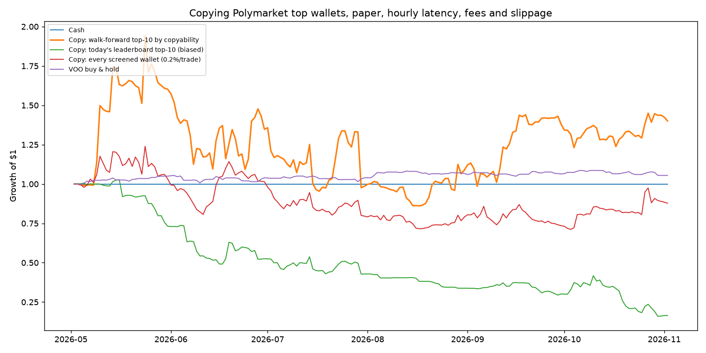

# Paper copy-trading Polymarket's top wallets

A simulated account that follows the most *copyable* wallets on Polymarket:
every hour it reads their new trades from Polymarket's public data API, mirrors
the ones that pass a set of rules into a paper portfolio priced off the live
order book, and reports once a day to your phone. It runs on GitHub Actions,
needs no keys and no money, and never places a real order.

Sibling of the [TVM / Kronos stock paper trader](../08-python-paper-trading-strategy/);
it reuses that project's notification channels.

## The "Claude finds the Polymarket wallets that win" pipeline, built honestly

The viral version of this idea has six screens. All six exist here, with
real data behind them:

| The post says | What this project does | Where |
|---|---|---|
| **Finds top wallets** - ranks public wallets by profit, win rate, consistency | Pulls the month / week / all-time / politics / sports leaderboards, screens out bots (>100 trades/day) and dormant accounts, then ranks by *copyability* (see below). Profit, win rate and consistency are computed and shown, but they are not the ranking key, because they are the leader's numbers, not yours | `polycopy/universe.py`, `polycopy/selection.py` |
| **Studies how they trade** - history, win rate, position sizing, favourite markets | Per-wallet profile from their full trade history: win rate over decided markets, realised PnL, average position, profitable months, category mix (politics / sports / crypto / ...), biggest markets | `polycopy/analysis.py`; the "Their record" column of every report |
| **Watches when they make a move** - new position / closed position feed | Every hour the job reads each followed wallet's new trades and logs them as *new position / added / reduced / closed*, with what we did about each one | `polycopy/paper.py` activity monitor; `state/activity.jsonl` |
| **Doesn't copy every trade** - liquidity, volume, price change, size checks | Every BUY goes through an 11-point review: leader size, market type, price range, freshness, time to resolution, market liquidity, 24h volume, spread, price move since the leader's fill (no chasing), current price, our position-size room. The report shows each check's value and pass/fail | `polycopy/review.py`; "Trade review" section of the report |
| **Copies approved positions** into a paper account | Fills walk the live order book, pay the market's taker fee, are sized at 1% of equity but never more than the leader's own notional; exits mirror the leader's; resolutions pay $1 / $0 | `polycopy/copy.py`, `polycopy/paper.py` |
| **$2,000 -> $12,000 in one night** | No. See the backtest below for what the same idea does over six months with real prices, latency and fees. A 6x overnight is a creator-reported screenshot, not a strategy property; a backtest that produced numbers like that here turned out to be a fill-model bug | `results/polymarket_backtest.md` |

## The idea, and why naive copying loses

Polymarket publishes every wallet's trades and a profit leaderboard, so
"copy the top of the leaderboard" is the obvious strategy. Replayed honestly it
loses money (see the red and green lines below) because:

- **The leaderboard is a hall of mirrors.** The top-10 by profit are whales and
  market makers. Many of their "buys" are one leg of a hedge, or sized so
  large that the price they got is not the price you get an hour later.
- **Latency.** A cron job sees a trade up to an hour late. Edge that lives for
  minutes (sports in-play, 5-minute crypto up/down markets) is gone by then.
- **Fees.** Polymarket now charges takers `shares x rate x p x (1-p)` in
  sports, crypto and politics markets (rate 3-7%). Copiers are always takers.

So the strategy ranks wallets by **copyability**, not by profit: every month it
replays each candidate's last 90 days *through our own rules* (hourly latency,
fees, slippage, position caps, size no larger than the leader's own trade) and
follows the ten whose copied version earned the most per unit of drawdown.
A wallet whose edge evaporates in an hour scores low no matter how rich it is.

## The rules (`polycopy/copy.py`)

| | default | why |
|---|---|---|
| Universe | top 50 by PnL on the month / week / all-time / politics / sports boards | public leaderboard, five views to catch different styles |
| Screen | drop wallets trading > 100 times/day or idle > 30 days | bots cannot be followed at hourly latency; dormant wallets give no signal |
| Follow | top 10 by copyability score, re-picked monthly (weekly in the live job) | `copy return / max(2%, drawdown)` on the trailing 90 days |
| Copy a BUY if | leader paid $25+, price in [0.03, 0.97], market ends 3h+ later, not an up/down or 5m/15m/1h market | skip dust, lottery tickets, near-certainties and markets we would enter after the fact |
| Size | 1% of equity per copied buy, never more than the leader's own notional, max 5% of equity per market | we take at most the liquidity the leader took |
| Don't chase | skip if the price is already more than 0.10 above the leader's fill | the edge was theirs at their price, not ours an hour later |
| Live-only review | market liquidity >= $1,000, 24h volume >= $500, spread <= 0.05 | current values only exist for open markets, so the backtest cannot apply these; they only make the live account stricter |
| Exit | mirror the fraction the leader sells; otherwise hold to resolution (paid $1 or $0) | copy the leader's exit decision, not our own |
| Fill price | **backtest:** the worse of the leader's price and the first hourly print after 60 min, plus 0.01; **live:** walk the real order book | hourly prints of thin books can be absurd for a moment; assuming we filled there would turn the backtest into a lottery |

## Backtest, May -> Nov 2026 ([`results/polymarket_backtest.md`](results/polymarket_backtest.md))

53 wallets survived the screen; their 225,000 trades were replayed against
hourly price history for every market touched (fetched once, cached in
`data_cache/`).



| portfolio ($10,000 start) | total | vol | Sharpe | max DD |
|---|---|---|---|---|
| **Copy: walk-forward top-10 by copyability** | **+40%** | 125% | 1.14 | **-56%** |
| Copy: today's leaderboard top-10 (knows who ended up rich) | -84% | 97% | -3.20 | -84% |
| Copy: every screened wallet, 0.2% per trade | -12% | 75% | 0.02 | -43% |
| VOO buy & hold | +5% | 12% | 0.93 | -5% |

1,548 copied buys, 533 positions carried to resolution (293 paid out), $1,705
of fees on a $10k account. Without the no-chasing rule (buy even if the price
is already >0.10 above the leader's fill) the same run makes +114% with a
-59% drawdown: the extra return comes from buying into news spikes, which
worked in this window and is exactly the behaviour that eventually does not.

**Read the +40% as "interesting", not as "expected".**

- It is **lumpy**. The ten best positions made several times the whole net
  gain; the single best was a leader putting $3,400 into *Russia x Ukraine
  ceasefire by May 31* at 6 cents four days before it happened. We paid 7
  cents. Most of the top winners are geopolitical long shots like that.
- It is **violent**. The account went $10k -> $17.8k -> $7.9k -> $12.8k, with
  days of -27% and +32%. Max drawdown -56%. Scale `trade_fraction` down if that
  is not acceptable; the copied set is otherwise unchanged.
- The **universe is survivor-biased**. Polymarket only publishes *today's*
  leaderboard, so even the walk-forward selection chooses among wallets that
  are known (in November) to have done well. Historical leaderboards are not
  available; the live paper run is the only clean test. The "every screened
  wallet" line losing money is at least evidence the bias is not doing all
  the work.
- Six months is short, and the followed set turns over: `surf` and
  `almost-never` carried May-August, `mr.ozi`, `ArielFilipino` and
  `TheReturnOfDarthMaul` carried the autumn.

The first version of this backtest said +1090%. The difference is the fill
model: it had assumed we could buy $500 of a token at a 0.016 hourly print
that lasted one hour in a market that then resolved in our favour. Every
number above uses the pessimistic fill rule in the table.

## Running it from your phone

[`.github/workflows/polymarket-copy.yml`](../.github/workflows/polymarket-copy.yml)
runs the paper account on GitHub's servers, hourly.

1. **Try it now.** Repo -> *Actions* -> *Polymarket copy trade* -> *Run
   workflow* -> mode `dry-run`. Two to three minutes later the run page shows
   who would be followed and what would have been copied this hour. No
   accounts or secrets needed. (Use a browser; the GitHub app can read runs but
   not start them. The workflow must be on the default branch for the button
   to appear.)
2. **Switch it on.** *Settings* -> *Secrets and variables* -> *Actions* ->
   *Variables* -> `POLY_COPY_ENABLED` = `true`. The hourly schedule starts
   with the next hour; the first run picks the followed wallets, which takes
   a while (about 15 minutes of API paging, cached afterwards).
3. **Done.** State lives on the `polymarket-copy-log` branch (`state.json`,
   `fills.jsonl`, `activity.jsonl` with every leader trade seen and every
   review); every Monday 06:00 UTC the followed set is re-picked; each day
   after 20:00 UTC a status message goes out. Each run's page shows the
   fills, the trade reviews (every check with its value), the hour's wallet
   activity, open positions and the followed wallets' records.

The daily message:

```
Polycopy 11/02: $10,412 (+4.1% since 11-02), 14 open positions, following 10.
Today: 3 buys, 1 sells, 2 resolved. Fees $6, max DD 2.3%.
```

**Default channel, no setup:** a comment on an issue titled *Polymarket copy
trading: daily status* that @mentions the repo owner, a push notification in
the GitHub app. Optional real SMS / ntfy / Telegram use the same secrets as the
TVM project; see its [Daily text message](../08-python-paper-trading-strategy/README.md#daily-text-message)
section. `TVM_GITHUB_ISSUE_NOTIFY=false` turns the issue comments off for both
projects.

Hourly runs use roughly 700 Actions minutes a month: free on a public repo,
about a third of the free quota on a private one. Change the first cron to
`12 */2 * * *` to halve it; latency in the backtest is a parameter if you want
to see what that costs.

## Running it locally

```bash
cd 09-python-polymarket-copy-trader
pip install -r requirements.txt
python -m pytest -q                       # 23 tests, offline

python run_backtest.py                    # walk-forward backtest; first run fetches ~500 MB of history (20-30 min)
python run_backtest.py --start 2026-07-01 --follow 5 --no-plot

python paper_trade.py --mode dry-run      # one hourly tick against live books, nothing saved
python paper_trade.py --mode live --reselect --no-notify   # real tick into ./state/
```

All Polymarket endpoints used are public and read-only. Settings are a JSON
file (`--config`) overriding any field of `CopyConfig`.

## Project layout

```
polycopy/api.py        Polymarket data-api / CLOB / Gamma client with a disk cache
polycopy/copy.py       CopyConfig, filters, sizing, Portfolio, LeaderBook, copy_trade()
polycopy/universe.py   leaderboard universe and the trade-rate / dormancy screen
polycopy/analysis.py   wallet profile: win rate, PnL, sizing, consistency, market categories
polycopy/backtest.py   hourly-price replay, bulk prefetch, metrics
polycopy/selection.py  copyability scoring and the follow set
polycopy/review.py     the per-trade checklist (liquidity, volume, spread, chase, size, ...)
polycopy/paper.py      the hourly live tick (activity monitor, review, live books, marks, resolutions)
polycopy/report.py     markdown / text status and notification plumbing
run_backtest.py        walk-forward backtest + report + chart
paper_trade.py         CLI used by the workflow
tests/                 offline tests with a fake API
```

## Caveats, honestly

- **Paper fills are optimistic in one way:** we walk the live order book at
  the moment the job runs, but a real order would also have to be posted and
  could be front-run or partially filled. Real copy trading would do worse
  than this paper account, not better.
- **Hourly latency is a choice.** A websocket follower reacting in seconds
  would copy a different, larger set of trades; it would also pay more fees
  and chase more spikes. The backtest's `latency_min` lets you price that.
- **Wallet profiles see CLOB trades only.** Splits, merges and early
  redemptions are not trades, so a market maker who buys both sides and
  merges them back to USDC looks like a total loss in "their record". The
  copyability score is unaffected (it only ever copies trades), but read the
  win-rate column as "how they trade", not as an audited P&L.
- **Prediction-market P&L is binary and clustered.** A handful of resolutions
  decide a quarter. Compared with VOO this is a different kind of risk, not a
  scaled-up version of the same risk.
- **Polymarket's API is not a contract.** Endpoints, limits (activity paging
  stops at offset 5000; price history is capped at 14 days per request and
  disappears from `interval=max` once a market closes) and fee schedules have
  all changed before. The client handles today's shape; expect to maintain it.
- Nothing here is investment advice, and the account is fake by design.
